<p align="center">
  
</p>

<p align="center">
  
  
  
  
  
  
  
</p>

<p align="center">
  <a href="#fonctionnalités">Fonctionnalités</a> ·
  <a href="#vos-notes-sont-protégées">Protection des notes</a> ·
  <a href="#installation">Installation</a> ·
  <a href="#développement">Développement</a> ·
  <a href="#où-sont-les-données">Données</a> ·
  <a href="#sécurité">Sécurité</a>
</p>

Application de bureau pour prendre des notes **en local**, sous Windows 11. Les notes sont de simples
fichiers HTML ou Markdown rangés dans un dossier : pas de compte, pas de cloud, pas de base de données.

Construite avec Electron 39, React 19, TypeScript 5.9 et electron-vite (Vite 7).

## Fonctionnalités

- **Notes HTML** avec un design system sombre : éditeur de code Monaco et aperçu éditable directement
  (menu de blocs « / », synchronisation du défilement entre le code et l'aperçu).
- **Notes Markdown** avec @uiw/react-md-editor.
- **Lecteur PDF** intégré, avec surlignages et citations insérées dans une note (lien vers la page).
- **Historique « Time Travel »** : versions successives de chaque note, restaurables.
- **Corbeille**, renommage et déplacement avec **mise à jour automatique des liens** entre notes
  (annulable).
- **Export** en PDF, DOCX et HTML autonome.
- **Panneaux IA** (Claude, ChatGPT, Gemini) et YouTube dans l'application.
- **Copilote et agent** basés sur [Ollama](https://ollama.com) en local.

## Vos notes sont protégées

<p align="center">
  
</p>

- Une note n'est jamais réécrite sans modification de votre part : ouvrir, cliquer, défiler ou quitter
  l'aperçu ne touche pas au fichier. Le reformatage n'a lieu que sur demande (Shift+Alt+F).
- Chaque écriture est **atomique** (fichier temporaire puis remplacement) : une coupure ou un fichier
  verrouillé par un antivirus ou OneDrive ne laisse jamais une note vide ou à moitié écrite. L'encodage,
  le BOM et les fins de ligne d'origine sont conservés.
- Si une note est modifiée ailleurs (autre éditeur, agent), l'application ne l'écrase pas : elle propose
  de **recharger**, de **garder votre version** ou d'**enregistrer une copie**.
- La saisie en cours est enregistrée avant la fermeture, y compris à l'arrêt de Windows.
- Toute restauration d'une ancienne version commence par sauvegarder l'état actuel dans l'historique.

## Installation

Prérequis : Windows 11, [Node.js](https://nodejs.org) (développé avec la version 24) et Git.

```powershell
git clone <url-du-dépôt> note-app
cd note-app
npm install
```

## Développement

> **Attention :** par défaut, l'application travaille sur le **vrai** dossier de notes
> (`%USERPROFILE%\Notes`). En développement, lancez-la toujours sur le dossier de test :

```powershell
npm run dev:safe
```

`dev:safe` définit `NOTE_APP_NOTES_DIR=./test-vault` : l'application n'ouvre que les notes de test du dépôt
et le titre de la fenêtre se termine par `[TEST-VAULT]`. Évitez `npm run dev` et `npm start`, qui
utiliseraient vos vraies notes.

<details open>
<summary><strong>Toutes les commandes</strong></summary>

| Commande | Rôle |
|---|---|
| `npm run dev:safe` | Lance l'application en développement sur `test-vault/` |
| `npm run typecheck` | Vérifie les types (processus principal et interface) ; doit rester à 0 erreur |
| `npm test` | Lance les tests Vitest (ils n'écrivent que dans le dossier temporaire du système) |
| `npx eslint <fichiers>` | Lint ciblé sur les fichiers modifiés (le dépôt a une dette de lint connue) |
| `npx electron-vite build` | Compile l'application dans `out/` |
| `npm run build:win` | Construit l'installateur Windows dans `dist/` |

Les scripts `build:mac` et `build:linux` existent mais ces plateformes ne sont ni testées ni prises en
charge.

</details>

Environnement conseillé : VS Code avec les extensions ESLint et Prettier. Style du code : Prettier, sans
points-virgules, guillemets simples, largeur 100.

## Où sont les données

Tout se trouve dans le dossier de notes (`%USERPROFILE%\Notes`, ou celui indiqué par `NOTE_APP_NOTES_DIR`) :

| Élément | Contenu |
|---|---|
| `*.html`, `*.md`, `*.pdf` | Vos notes et documents |
| `*.pdf.annotations.json` | Surlignages et commentaires d'un PDF |
| `.history/` | Versions successives des notes (Time Travel) |
| `.trash/` | Corbeille |
| `.recovery/` | Écritures interrompues récupérées au démarrage (après un arrêt brutal) |
| `.snippets/snippets.json` | Blocs proposés par le menu « / » |
| `.templates/` | Modèles de notes |
| `.config.json` | Favoris, tags et réglages |

Sauvegarder ce dossier suffit à sauvegarder toutes vos notes et leur historique.

## Organisation du code

<details>
<summary><strong>Voir l'arborescence</strong></summary>

| Dossier | Contenu |
|---|---|
| `src/main/` | Processus principal : fichiers, fenêtres, sécurité, historique, export, agent Ollama |
| `src/preload/` | Pont entre l'interface et le processus principal (`window.api`) |
| `src/renderer/` | Interface React (application, éditeurs, lecteur PDF, panneaux) |
| `src/shared/` | Logique pure partagée et testée (liens, chemins, nettoyage HTML…) |
| `test-vault/` | Notes de test utilisées par `dev:safe`, dont des notes de test de sécurité et de sauvegarde |
| `docs/` | Spécification cible (`SPEC.md`), note de référence du design system, images du README |

</details>

Les règles de développement du projet (sécurité, écritures, conventions, pièges connus) sont décrites dans
[`CLAUDE.md`](CLAUDE.md).

## Sécurité

- Tout chemin reçu par l'interface est confiné au dossier de notes.
- L'application n'ouvre dans le système que des adresses `http`, `https` et `mailto` ; les panneaux web ne
  peuvent ni charger de code local ni activer Node.js.
- **Travail en cours :** isolation complète du JavaScript contenu dans les notes HTML. Pour l'instant,
  n'ouvrez pas de note HTML d'origine inconnue.

`test-vault/securite/note-piegee.html` est une note de test de sécurité : ne la copiez jamais hors de
`test-vault/`.
